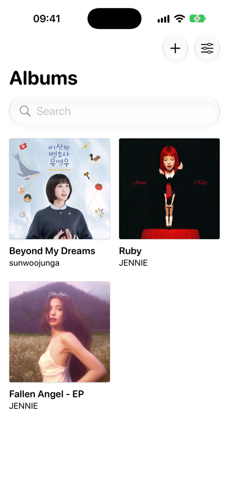
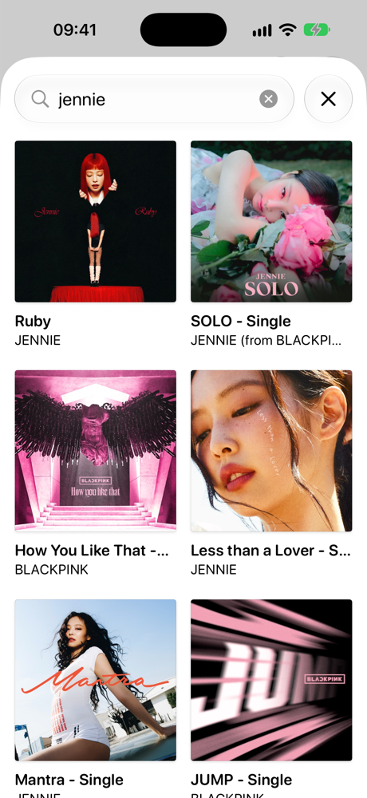
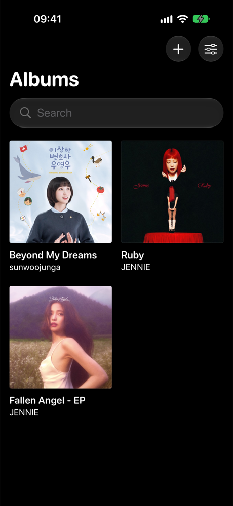

# EAlbums

A small iPhone app to keep the albums, EPs, singles and songs you love from Apple Music or YouTube Music, and see
them on your Home Screen.

- **Search Apple Music or YouTube Music** from a Liquid Glass search bar and tap a result to keep it. Kept releases
  are dimmed; tap one again to take it off. Pick the service under *Add From* in the options menu (Apple Music by
  default).
- **YouTube Music** releases open on their own page in the YouTube Music app (or music.youtube.com without it).
  YouTube Music has no public search API, so EAlbums asks the one its website uses, with no key and no account.
  Google can change it without notice: the search would then fail, while everything already kept keeps opening.
- **Albums**: everything you keep in two columns, searchable. You can sort it by date added, title or artist, and
  filter it by albums, EPs, singles or songs. Tap a cover to open it in Apple Music or YouTube Music, wherever you
  found it.
- **Widgets**: *Cover* shows one cover edge to edge and changes every hour. *Albums* shows a row of three or a wall of
  nine covers. Tapping a cover opens it in its music app.

SwiftUI, iOS 26, Swift 6, MusicKit, YouTube Music, WidgetKit. Covers only, in SF Pro Rounded.

<p align="center">
  
  
  
</p>

## Build it

1. Copy the signing settings and fill in your team and a bundle id prefix you own:

   ```bash
   cp Config/Secrets.example.xcconfig Config/Secrets.xcconfig
   ```

2. On [developer.apple.com](https://developer.apple.com/account/resources/identifiers/list), open your app's
   identifier (`<prefix>.EAlbums`) and enable **MusicKit** under *App Services*. Without it, every search fails with
   "Failed to request developer token".
3. Sign in to your Apple account in Xcode (Settings > Accounts). Automatic signing then creates the App Group
   `group.<prefix>.EAlbums` that the app and its widgets share.
4. Build and run the `EAlbums` scheme.

In Debug, launching with `-preview-catalog` shows made-up search results instead of Apple Music, and
`-screenshotSearch <words>` opens the add sheet already searching (how the screenshots above were taken).

## How it is put together

- **Architecture**: MV, with no view models. There is one `@Observable` store per source of truth: `ShelfStore` for
  the kept releases, `CatalogSearchStore` for the search and `ServiceStore` for the music service picked. Services
  sit behind protocols, so tests use fakes: `MusicCatalog` has `AppleMusicCatalog` (MusicKit) and
  `YouTubeMusicCatalog`, and `ServiceCatalog` searches the one picked.
- **`Shared/`**: code the app and the widgets both compile.
  - `Release` is the data for one release.
  - The shelf is a JSON file in the App Group (`FileShelfStorage`, `SharedShelf`).
  - `Spotlight` picks which covers a widget shows.
  - `MusicLink` builds the `ealbums://` link that carries a widget tap into the app.
- **Opening a cover from a widget**: a widget can only open its own app. A tapped cover therefore opens EAlbums
  with that link, and EAlbums passes the Apple Music or YouTube Music page on to its app.
- **Tests and lint**: tests come first, written with Swift Testing. SwiftLint runs on every build and must stay clean.

```bash
swiftlint lint
xcodebuild test -project EAlbums.xcodeproj -scheme EAlbums -destination 'platform=iOS Simulator,name=iPhone 17 Pro' -skipPackagePluginValidation
```

## License

MIT, see [LICENSE](LICENSE).
